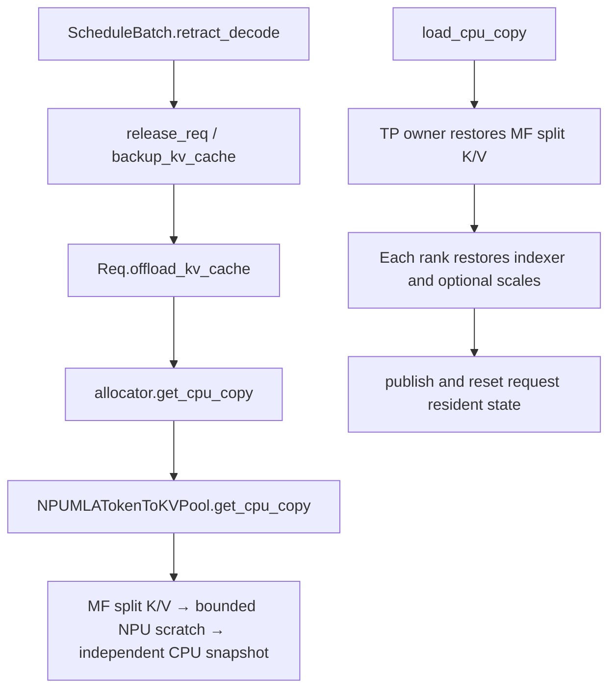

# 本次交接的验证范围

记录日期：2026-11-04。本次提交提供回退修复、两机 PD 控制器、冻结压测客户端和容器构建脚本。真实 MF TP16 小探针、CopySFA 三个设备用例、kernel 构建及完整 BS16 controller 已通过。固定三输入取值与17次真实回退恢复对齐；五轮正式中位数310.265693 output tokens/s。通用模型评测、新增性能cache专项及BS扩展尚未完成，不能扩大已验证范围。

| 项目 | 结果 | 范围 |
| --- | --- | --- |
| 原始 NoneType 回退问题 | CPU 重现后修复 | 原版读取 `self.k_buffer=None`；修复改读权威 MF split K/V |
| Linux 完整测试模块 | 8/8，通过，exit 0 | 2 项新增 retraction 测试、6 项既有 MF CPU 测试；MF/设备边界使用模拟 |
| 自动控制器自检 | 28/28，通过，exit 0 | 真实本机 HTTP/SSE、错误/cache 门禁、默认冻结客户端及 stdlib 的 2 warmup + 5 formal 模拟流程、活跃 BS、异常退出码；另覆盖精度 fixture/答案门禁、PF_EXITING 等待和性能配置的 prefix 准确性门禁 |
| 冻结资产与报告自检 | 3/3，通过，exit 0 | 原始 SHA、BS16 pickle 原字节、BS20 扩展、seed 1 输出、正式 1024 输出及 cached63872、输入缓存命中 |
| 静态检查 | 通过 | Ruff 0.15.1、isort 7.0.0、codespell 2.4.1、AST、空白/EOF、Bash 语法、文件大小与 diff check |
| kernel 构建及安装 | 通过，exit 0 | 217 A3/CANN 9.1.0 构建；两侧安装同一 wheel，检查 split K/V 算子 schema |
| 真实 MF 回收/恢复小探针 | 16/16 rank 通过，exit 0 | 每 rank 39 项检查，原始字节校验跨页 K/V、owner 恢复和每 rank index/scale；reset 为 spy |
| CopySFA eager/graph | 3/3，通过，exit 0 | Q4 跨页、128 head、C12288 Q4 首填；独立 CPU oracle 最大绝对误差分别为 0.00066914、0.00065416、0.00059916 |
| PD 首次尝试 | 失败，exit 1，已补启动门禁 | P/D 服务 ready 后 router 尚无 P worker，首组请求 503；不能记作精度或性能结果 |
| 完整 BS16 PD、固定输入精度与吞吐 | 通过，exit 0 | 三组10请求正确且forced对native exact，3请求共17次回退；5轮全留median310.265693；不是通用模型评测 |
| 新增性能cache专项、BS扩展 | 待验证 | 性能D的decode prefix cache组合新增显式语义门禁，七轮冻结随机计时不变 |

Linux 8 项测试使用 Python 3.12.13、torch 2.10.0+cpu、torch_npu 2.10.0.post6、memfabric_hybrid 1.3.0。采集日志结束时间为 `2026-11-03T23:16:50+00:00`，pytest 输出 `8 passed, 15 warnings in 12.28s`。修复文件的 SHA256 为 `3faf59ed016a26bfe5447f7bf4dfa7c02a4f663fccfb911164aac20e9319a5c9`；新增 retraction 测试文件为 `339177370819502c9ff25944f8478ae31c24b8e5fc8fefeda02357e49f9585fa`。本次发布前核对过这两个文件与当时通过测试的版本一致。

全量 `scripts/lint/check_registered_tests.py` 检查退出 1：基线已存在的 `test/registered/unit/hardware_backend/test_npu_sparse_dispatch.py` 缺 CI 注册。本次没有修改该文件，也未将这一检查描述为通过。新增 retraction 测试包含 CPU CI 注册和 `unittest.main()`。

修复对应的调用链如下。新增搬运发生在回退/恢复路径，普通 decode 的计算路径未添加操作。

历史参照为旧单机 TP16/DP1、BS16 的 `203.723894` output tokens/s，使用选定三轮子集的中位数。本次脚本冻结相同客户端和 64000/1024、prefix100、C12288、mode1、NEXTN3/Q4、BF16 KV 等已知条件，但使用两机 PD，并保留全部五轮正式结果。性能 D 额外启用实验性的 radix prefix 复用，避免 163840-token 池把 16 路 HTTP 请求实际限制为约两条独立 64K decode；所有 D 阶段额外请求槽固定为 0。以上差异须与实际服务配置和活跃 BS 一起报告，不能把旧单机数值或 CPU 模拟值当成本次 PD 结果。

可重复检查命令见 [README](README.md)。运行产生的 `config.json`、`runtime.json`、环境、服务日志、完整旧客户端报告、逐请求 JSONL、`summary.json` 和退出码，是容器实测结果的依据。

## 启动包装器的 spawn 回归修复

用户随后提供的日志在 `no_thp_launch.py:11` 重入 SGLang 启动，原始异常是 `An attempt has been made to start a new process before the current process has finished its bootstrapping phase`。调用链为 `Engine._launch_scheduler_processes → proc.start → spawn.prepare → runpy.run_path(__mp_main__) → no_thp_launch.py → runpy.run_module(sglang.launch_server)`。顶层执行的包装器在 spawn 导入主模块期间再次启动服务。日志中的另一处 `RecursionError` 出现在 `torch_npu` 异常钩子，不能据此把首错归为 KV 或 attention kernel 故障。

修复将 THP 系统调用、参数设置和服务启动全部放入 `main()`，由 `if __name__ == "__main__"` 保护。新增 3 项 CPU 单测覆盖普通/`__mp_main__` 导入无副作用、参数转发与单次启动，以及 prctl 失败时停止启动。另提供 `test_spawn_startup.py`，用真实 multiprocessing spawn、假的 SGLang 服务和 ctypes 边界，验证只启动一个父服务入口及一个子 worker。

本地 Windows Python 3.12 回放结果：旧 `90a6d765` 包装器退出 1，出现相同 bootstrapping 错误，记录到两次服务入口；修复版退出 0，记录到一次 prctl、一次服务入口和一次子 worker，参数保持一致。3 项单测也全部通过。该回放未加载真实 SGLang 模型、调用真实 THP 系统调用或初始化 NPU；容器中的真实服务启动与 PD 验证仍需重跑。

## 地址预检与扩大功能对照

用户在实际参数中填入 `--prefill-host 809`，随后 Prefill 初始化经过 `get_local_ip_auto → get_zmq_socket_on_host`，在 `tcp://809:*` 报 `Cannot assign requested address`。脚本现要求完整 IPv4，并在 NPU runtime 导入前只检查当前角色地址能否本地绑定。CPU 自检新增错误简称、地址类型、真实 loopback 绑定、对端地址不在本机绑定以及 `EADDRNOTAVAIL` 提示覆盖。

功能对照现使用关闭 offload 的原生 Decode 作为参考；开启 offload 并强制回退后，分别对 512/64、4096/64 各四条 greedy 请求逐 token 比较并检查回退次数。控制器的 13 项 CPU 自检通过，仍不代表真实模型已通过这些对照。性能阶段维持两轮 warmup、五轮 formal，每轮只清缓存一次；所有阶段合计 11 次清缓存被自检覆盖。

新增两个设备探针供本轮 209/217 验证使用：`probe_mf_retraction.py` 检查真实 MF/NPU/TP 的共享 K/V 快照和原始字节恢复；`probe_copy_sfa.py` 复用 kernel 仓库的三个 eager/graph 精度用例并打印误差。初次发布时仅静态检查，随后已取得上表范围内的真实设备结果。

## 209/217 实机准备与首轮 PD 修正

两侧为同一 B103 镜像、Python 3.12.13、torch 2.10.0+cpu、torch_npu 2.10.0.post6、MF 1.3.0；各使用 16 个 A3 die。模型 config、量化描述、权重索引和 tokenizer 配置的 SHA 在两侧一致；未对 404.8 GB 全量权重重新计算 SHA。Prefill 的 BF16 KV 分配约 16.77 GB，draft KV 约 0.22 GB。

配套 kernel 基线为 `b47332ce9736a7920139ad8f29364b27ef416dea`；构建时只在任务副本限制编译并发和规范化 shell LF。实际 wheel SHA256 为 `5de65d7eb4ee9acda2f86007eb02ada47ed71e4c0c390645c8dd70a6cac1286c`，两侧主 SO SHA 为 `0b27a873ddd35b789cbe649c1dd17509b6ffac4e62b88829ce856bbb502096f7`。

MF 1.3.0 wheel 的 AccOffload 库为官方零字节占位。用随包官方构建器在私有前缀生成 718752 字节 A3 ELF，SHA256 为 `7e30b856a5e1a37bece3ef18f9a8b60f054901ef0e38aa00176d7cbc668d1550`，原 site-packages 未修改。真实 MF TP16 探针使用此私有库通过。新增 `setup_memfabric.sh` 封装同一构建机制，随后已在 217 新目录 `/workspace/splitkv-pd-live/mf-wrapper-validation` 完整执行，外层及 `setup.exit` 为 0，ELF/CDLL 与原 source 库未变检查通过；新产物 718752 字节，SHA 为 `3e87649f4d2ea85936cd94b439afd3473973bd62abcc06f777c9b875cf1a9d46`。未分析两次构建的字节差异，新产物未再次跑 TP16，生产继续原已验证库。

首次 D 运行目录为 `/workspace/splitkv-pd-live/runs/decode-20261104T073438446307Z`。首错为 router `No available servers: No prefill workers available`；`/health` 已返回 200，后台 `/workers` 尚未注册 P。单独实际查询确认 router 0.3.2 异步注册，因此新增精确 URL、角色和健康状态等待，不能靠固定延时。退出阶段还暴露 `/proc/stat` 读取活进程、随后 `environ` 已清空并变成 zombie 的竞态；清理逻辑新增状态与进程身份复核。

功能对照扩大为 512/64、4096/64 各四请求和 64000/64 两请求，参考与强制回退逐组比较；性能仍为两轮 warmup 与五轮全部保留的 formal。全部阶段共清缓存 13 次。这些控制器测试包含模拟服务，实际整模结果以新运行日志为准。

第二次运行目录为 `/workspace/splitkv-pd-live/runs/decode-20261104T075657552274Z`。正确通过 router worker 门禁后，native 512/64 首组四请求均 HTTP 200，但 `reference-short-1` 的第 2 token 为 241，其他三条为 112；其后输出也不同，因此原生一致性门禁失败，未运行强制回退或性能。`reference-short-1` 与 `reference-short-3` 的 cached_tokens 都是 384，但只有前者不同，不能仅据此把原因归为缓存。独立原生诊断将保存顺序/并发请求的 logprob 与批次信息，尚无原因结论。

第二次退出也遇到 token 缺失，说明仅立即重读 stat 仍不足以覆盖现场进程生命周期。新清理逻辑对同 session 的缺失 token 最多等待一秒，期间检查状态、birth、session 和标记；未知活进程持续存在仍报错，带 state/ppid/pgrp/session/flags/birth 证据。23 项 CPU 控制器自检通过，覆盖时间虚拟的延迟标记、持续未知和身份变化；此补充仍待真实退出路径验证，不宣称现场根因已确认。

## 独立自然语言精度 oracle

保留原随机输入的全部失败结果后，独立诊断增加了 warm、逐次 flush 的顺序请求和并发请求，13 请求中仍有一条从第二 token 分叉。teacher-force 将原输入加上首 token 构成 513 token，只要求输出一个 token，四次逐次 flush 的输出为 `112/241/112/112`。P 日志各有一次 513-token prefill，D 同时间段只有 flush 和请求完成、没有 target decode batch；因此变化无需进入 D target forward 或回退恢复代码即可出现，不能由此判定 MF transfer 已错或已正确。模型数值/状态根因尚未解决。

将精度和性能输入明确分开：精度使用固定自然语言文首密钥取值，模板关闭 thinking，输入精确为 512/4096/64000 token；性能继续历史随机输入。独立原生诊断中，short 的 warm + 四次顺序 + 四次并发均正确且逐 token 一致，long 四请求、target64k 两请求也正确且一致；64-token 输出实际为重复密钥的截断前缀，不冒称输出六十四行。三份原始 JSON 已按 SHA 冻结到 `fixtures/precision/`，在候选强制回退前确定；门禁继续要求正确答案、组内 exact、候选对原生 exact 和实际 retraction，不以放宽 token 差异阈值处理。

该独立原生结果不是完整 controller 或强制回退通过，也不是通用模型精度得分。原生 64K 取值诊断的 cached token 为 63360，性能仍严格检查每请求 63872，二者输入和用途不同。

## 完整 BS16 controller 结果与后续 cache 专项

在 `dd2fe408d770334f467b64955ae9d64954012424` 驱动、相同 254fce93 服务端核心下，209 P / 217 D 完整 BS16 controller 已通过，退出与清理均为 0。原生与 forced 三组共各十条请求：答案正确，候选逐 token 对齐参考；实际回退分别 `[0,0,0,6]`、`[0,0,0,6]`、`[5,0]`，即三条请求共回退17次，另外七条是并发控制。原来的 MF host-backed 回退不再读取空 native K/V；这是固定三输入、BF16 KV 和该 TP16 配置的实机覆盖。

两轮预热为 279.678281、336.179454 output tokens/s。五轮正式全部保留：314.285515、294.316999、310.265693、312.411012、279.010060；中位数 **310.265693**、范围279.010060–314.285515、总体标准差13.52918。每轮16/16完成，逐请求64000输入、1024输出、cached63872，实际decode running BS达16。它是客户端测量窗口输出吞吐，前缀seed独立计时，不是scheduler瞬时decode吞吐。旧203.723894是单机TP16/16die、筛选clean三轮的中位数；本次两机各TP16共32die、五轮不筛，不能把差值全归因于回退补丁。

该次性能D启用实验性decode radix prefix cache，而前面的自然精度在D cache关闭的reference/forced配置下执行。为补足这个组合的答案验证，新增性能D ready后、七轮计时前的64K语义seed+BS并发64-token准确性门禁，要求与原生exact、正确答案且实际有cache hit；七轮冻结随机性能流程原样保留。正常完整流程因此共14次flush。此新增cache专项在BS16旧运行中未执行，将在BS扩展实机运行中验证，不倒填为BS16已有证据。

本轮期间长时间保留的旧P曾在MF `AccTcpWorker` native栈段错误，之后出现Gloo peer断开；SMEM对旧D端口重连与该错误因果未确认。恢复P后上述完整controller完成，不把重启称为MF根因修复。新实验每次干净启动两端，并继续保留失败证据。
